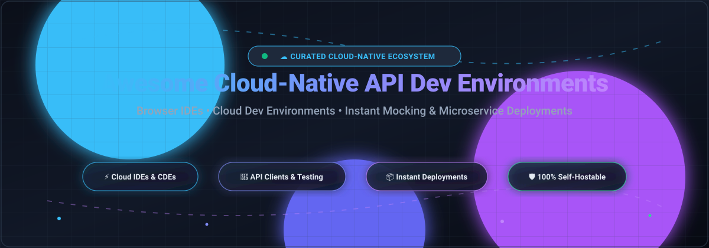

# ☁️ Awesome-Cloud-Native-API-Development-Environment

  

  
  
  
  
  
  

---

## 🚀 Top Cloud-Native API Development Environment Ecosystem

**A Curated List of SaaS Platforms & Open-Source Tools for Cloud-Native API Engineering**  
*Comprehensive directory of Browser-Based API Tooling, Cloud Development Environments (CDEs), Web IDEs, Microservice Mocking, and Instant Cloud Deployments.*  
**📅 Last updated: March 2026**

This repository provides an authoritative, SEO-optimized knowledge base tracking notable **SaaS platforms** and **open-source projects** in the **Cloud-Native API Development Environment** space. These modern developer tools offer zero-setup, browser-accessible, and containerized workspaces for designing, mocking, inspecting, testing, and deploying REST, GraphQL, gRPC, and WebSocket APIs—eliminating the "it works on my machine" problem while streamlining developer workflows.

---

## 📑 Table of Contents
- [📊 Sector Overview & Market Dynamics](#-sector-overview--market-dynamics)
- [🏢 SaaS / Hosted Platforms](#-saas--hosted-platforms)
- [🔓 Open-Source GitHub Projects](#-open-source-github-projects)
- [🛠️ Key Frameworks for Building Custom Cloud IDEs](#️-key-frameworks-for-building-custom-cloud-ides)
- [🤝 How to Contribute](#-how-to-contribute)
- [💖 Support & Sponsorship](#-support--sponsorship)
- [📈 Star History](#-star-history)
- [⚠️ Disclaimer](#️-disclaimer)

---

## 📊 Sector Overview & Market Dynamics

The global Cloud-Native API and Developer Environment market is estimated at approximately **$6.2B - $8.5B**, growing at a robust CAGR of **~22%–26%**, accelerated by the rapid industry shift toward Cloud Development Environments (CDEs), remote developer platforms, AI-native programming assistants, and API-first architectures. 

The sector displays **moderate fragmentation**:
- **Ecosystem Hyperscalers:** Microsoft/GitHub (Codespaces) and Amazon AWS (Cloud9) provide foundational, compute-tied cloud dev workspaces anchored by massive infrastructure scale.
- **Specialized Category Champions:** High-growth platform leaders dominate specific lifecycle phases—Postman in collaborative API design and testing, Vercel and Render in zero-config serverless deployments, and Replit in real-time collaborative cloud runtime environments.
- **Open-Source & Offline-First Contenders:** Developer-sovereignty solutions such as Hoppscotch, Bruno, LocalStack, and Coder are surging in adoption as enterprise teams push back against seat licenses, egress fees, and vendor lock-in.

---

## 🏢 SaaS / Hosted Platforms

A breakdown of top hosted developer platforms with verified starting pricing, valuation, and exact free tier/trial limits:

| Product | Scale (Valuation / Revenue) | Description | Pricing (Starting) | Free Tier / Trial Limits |
|---------|-----------------------------|-------------|-------------------|--------------------------|
| **[AWS Cloud9](https://aws.amazon.com/cloud9/)** | **~$2.2T** market cap (parent Amazon; AWS ~$105B+ run-rate) | Browser-based IDE with integrated terminal, debugger, and AWS tooling pre-installed on managed EC2 instances. | $0 base charge (pay only for AWS EC2/EBS resources used, e.g. t2.micro at ~$0.0116/hour) | **AWS Free Tier**: 750 hours/month of t2.micro or t3.micro Linux instances for 12 months for new AWS accounts; existing accounts pay standard underlying resource rates |
| **[GitHub Codespaces](https://github.com/features/codespaces)** | **~$3.1T** market cap (parent Microsoft; GitHub ~$2B+ ARR) | Cloud development environments tightly integrated with GitHub repos, devcontainers, prebuilds, and browser/desktop VS Code. | Pay-as-you-go starting at $0.18/hour (2-core Linux) and $0.07/GB-month for storage | **Free**: 120 core-hours/month (approx. 60 hours on 2-core machine) + 15 GB-month storage included with every personal GitHub Free account; 30-min idle auto-suspend |
| **[Postman Cloud Platform](https://www.postman.com/)** | **~$5.6B** valuation (~$250M+ ARR) | Comprehensive API development platform featuring collections, automated tests, mock servers, monitors, and AI assistants. | Basic plan at $14/user/month (annual billing) or $19/user/month (monthly billing) | **Free**: 1 team workspace, up to 3 collaborators, unlimited collections and mock servers, 1,000 cloud monitoring requests/month, and 50 Postman AI Assistant requests/month |
| **[Replit](https://replit.com/)** | **~$3.0B** valuation (~$50M+ ARR) | Browser-based collaborative development environment featuring autonomous AI Agent, instant app hosting, and integrated databases. | Core plan at $20/month ($204 billed annually at $17/month) | **Starter (free)**: unlimited public repls, basic workspace resources (0.5 vCPU, 500 MB RAM), 1 published app deployment, and daily limited AI assistant prompts |
| **[Vercel](https://vercel.com/)** | **~$2.5B** valuation (~$100M+ ARR) | Frontend and API cloud platform enabling automated git deployment, edge functions, and serverless API endpoints. | Pro plan at $20/month per member (includes $20 credits for usage) | **Hobby (free)**: unlimited personal deployments, 100 GB fast data transfer/month, 1M edge middleware invocations, 100 GB-hours function execution; strictly for non-commercial projects |
| **[CodeSandbox](https://codesandbox.io/)** | **~$200M** valuation | Cloud development platform combining fast browser micro-sandboxes with scalable virtual machine cloud dev environments. | Pro plan at $18/user/month ($15/month billed annually) | **Free**: 400 monthly workspace credits (~40 hours on Nano VM), up to 20 private sandboxes, and unlimited public sandboxes |
| **[Gitpod](https://www.gitpod.io/)** | **~$150M** valuation | Automated ephemeral cloud development environment platform featuring prebuilds, multi-IDE support (VS Code, JetBrains), and custom Docker setups. | Pay-as-you-go / Pro starting at $9/user/month for additional resources | **Free**: 50 hours/month of standard workspace usage (up to 4 parallel workspaces, 30-minute inactivity timeout) |
| **[Render](https://render.com/)** | **~$150M** valuation (~$15M+ ARR) | Modern unified cloud platform for hosting web services, background workers, scheduled cron jobs, and managed databases. | Individual Starter compute at $7/month per web service + $7/month for Starter PostgreSQL | **Free**: 750 free instance hours/month for web services (spins down after 15 min inactivity), free PostgreSQL (256 MB RAM, expires after 30 days), and 100 GB bandwidth/month |
| **[StackBlitz](https://stackblitz.com/)** | **~$100M** valuation | Browser-native IDE running entirely on client WebContainers (in-browser Node.js runtime) with instant startup and offline capability. | Practitioner / Pro plan at $15/user/month ($12/user/month billed annually) | **Personal (free)**: unlimited public projects, instant dev server booting via WebContainers, 1 MB file upload limit, and direct GitHub repo synchronization |
| **[Glitch](https://glitch.com/)** | **~$50M** valuation (subsidiary of Fastly) | Lightweight browser-based web application and API creation environment designed for fast remixing and live collaboration. | Pro plan at $10/month ($96 billed annually at $8/month) | **Free**: public project hosting, 200 MB disk storage per app, 512 MB RAM, full code editor; apps sleep after 5 minutes of idle time (up to 4,000 project hours/month) |

---

## 🔓 Open-Source GitHub Projects

Self-hosted, vendor-neutral tools and runtimes sorted by GitHub stargazers count:

| Project | Star Badge | Description |
|---------|------------|-------------|
| **[Hoppscotch](https://github.com/hoppscotch/hoppscotch)** |  | Open-source API development ecosystem (self-hosted Postman alternative). Lightweight browser and desktop API testing client supporting REST, GraphQL, and WebSockets. |
| **[code-server](https://github.com/coder/code-server)** |  | Run VS Code on any remote Linux machine and access it directly through any modern web browser with full extension and terminal support. |
| **[LocalStack](https://github.com/localstack/localstack)** |  | Fully functional local and containerized AWS cloud emulator for developing and testing cloud-native APIs, Lambdas, and serverless workflows without cloud costs. |
| **[Bruno](https://github.com/usebruno/bruno)** |  | Fast, Git-friendly, and offline-first open-source API client that stores collections directly in local repository folders using plain text markup (Bru). |
| **[Insomnia](https://github.com/Kong/insomnia)** |  | Open-source desktop and cloud API design, debugging, and testing platform maintained by Kong with OpenAPI generation and environment management. |
| **[Swagger UI](https://github.com/swagger-api/swagger-ui)** |  | Standard interactive web-based UI framework for dynamically generating and interacting with OpenAPI (Swagger) API definitions. |
| **[Eclipse Theia](https://github.com/eclipse-theia/theia)** |  | Extensible, vendor-neutral cloud and desktop IDE framework supporting VS Code protocols, widgets, and multi-language language servers. |
| **[Coder](https://github.com/coder/coder)** |  | Self-hosted developer workspace platform provisioning remote cloud environments on Kubernetes, VMs, or bare metal using standard Terraform templates. |
| **[DevPod](https://github.com/loft-sh/devpod)** |  | Client-only developer environment orchestrator using Devcontainer specs that spins up workspaces on any Kubernetes cluster, cloud VM, or local Docker daemon. |
| **[Mockoon](https://github.com/mockoon/mockoon)** |  | Open-source local mock API server tool to easily simulate REST APIs with custom routes, JSON schemas, rules, proxies, and CLI Docker integration. |
| **[WireMock](https://github.com/wiremock/wiremock)** |  | Flexible API mocking and service virtualization tool supporting HTTP stubs, verification, fault injection, and stateful scenarios in cloud-native test suites. |
| **[Eclipse Che](https://github.com/eclipse-che/che)** |  | Kubernetes-native cloud development environment platform that runs containerized IDE workspaces and devfiles on Red Hat OpenShift and Kubernetes. |
| **[OpenVSCode Server](https://github.com/gitpod-io/openvscode-server)** |  | Production-grade upstream VS Code running directly in a web browser, maintained by Gitpod for self-hosted containerized development environments. |

---

## 🛠️ Key Frameworks for Building Custom Cloud IDEs

To build a customized, self-hosted Cloud-Native API development ecosystem, consider combining:
- **Editor Layer:** [code-server](https://github.com/coder/code-server) or [OpenVSCode Server](https://github.com/gitpod-io/openvscode-server) for full in-browser VS Code ergonomics.
- **IDE Framework:** [Eclipse Theia](https://github.com/eclipse-theia/theia) for white-label or deeply customized tool suites.
- **API Testing & Prototyping:** [Hoppscotch](https://github.com/hoppscotch/hoppscotch) or [Bruno](https://github.com/usebruno/bruno) for collaborative request authoring and Git-backed collections.
- **Local Cloud Emulation:** [LocalStack](https://github.com/localstack/localstack) for offline AWS API testing.
- **Workspace Orchestration:** [Coder](https://github.com/coder/coder) or [DevPod](https://github.com/loft-sh/devpod) for automated container and VM lifecycle management across Kubernetes or hybrid infrastructure.

---

## 🤝 How to Contribute

Contributions are warmly welcome! Help keep this ecosystem guide accurate and comprehensive:

1. 🍴 **Fork** this repository.
2. 🌿 **Create a branch** for your updates (`git checkout -b feature/add-new-tool`).
3. 📝 **Add or edit entries** in `README.md` keeping formatting consistent (Name, Description, Pricing, Limits, Badges).
4. 📬 **Submit a Pull Request** with a clear explanation of changes.

---

## 💖 Support & Sponsorship

If you find this curated list valuable for your daily engineering workflow or team architecture, please consider showing your support:

- 🌟 **Star** this repository on GitHub to boost visibility.
- 🍴 **Fork** and share it with fellow developers and platform engineering teams.
- ☕ **Buy a Coffee / Sponsor**: Support ongoing maintenance and curation on the [GitHub Sponsor Dashboard](https://github.com/sponsors/ishandutta2007).

Your support keeps this directory independent, accurate, and actively maintained! 🙌

---

## 📈 Star History

---

## ⚠️ Disclaimer

- This is a **community-curated** list — not exhaustive and not a paid endorsement.
- Cloud development environments execute arbitrary code and expose terminal access; enforce proper authentication, network isolation, and workspace cleanup to prevent resource abuse.
- Core-hour billing (GitHub Codespaces) and credit-based billing (CodeSandbox, Replit) can consume quotas quickly on multi-core machines; configure idle timeout settings to avoid unexpected charges. Always verify current tiers on vendor pricing pages.

---

  <b>Built with ❤️ for developers, platform engineers, and cloud architects worldwide.</b> 
  Let's make cloud API development environments more open, accessible, and cost-transparent.

